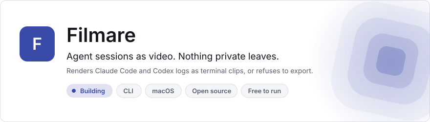
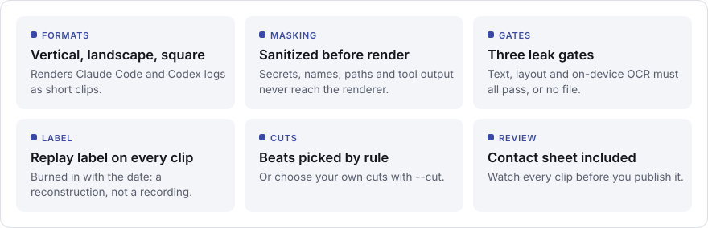
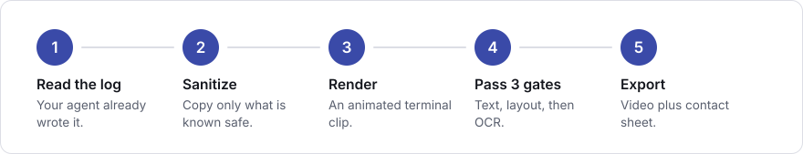
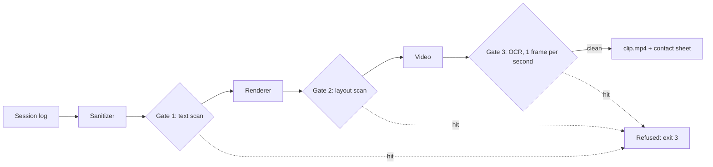

<!-- Pictures: docs/readme/spec.json, drawn by readme-kit. Do not edit the SVGs by hand. -->
<picture><source media="(prefers-color-scheme: dark)" srcset="docs/readme/hero-dark.svg"></picture>

**Your agents already write logs. Filmare cleans one and renders it as an animated terminal clip.**

Filmare records nothing. It refuses to export a clip if it can still find anything private. It uses no AI and no API credits, and it costs nothing to run. It runs on macOS and is in active development.

[Quick start](#quick-start) · [Commands](#commands) · [Privacy model](#how-it-keeps-private-data-out) · [Limits](#what-it-cannot-promise) · [Credits](#credits)

## What it does

<picture><source media="(prefers-color-scheme: dark)" srcset="docs/readme/highlights-dark.svg"></picture>

## How it works

<picture><source media="(prefers-color-scheme: dark)" srcset="docs/readme/steps-dark.svg"></picture>



## Quick start

```bash
git clone https://github.com/zaitsew/filmare && cd filmare
./setup.sh                                  # installs the renderer and helpers, creates your config
$EDITOR ~/.config/filmare/config.toml       # the names and files to keep out of videos
filmare list                                # recent sessions
filmare render <session-id> -o clip.mp4     # a short vertical clip, or a refusal
```

On success `render` prints three lines (the angle brackets are placeholders) and writes `clip.sheet.png`, a contact sheet, beside the video:

```text
<video>: <seconds> s, <beats> beats, speed <speed>.
Both leak gates passed, <frames> frames read.
Review it before publishing. Contact sheet: <sheet path>
```

It runs on macOS and needs [Bun](https://bun.sh), `ffmpeg` and Python 3.14. `filmare doctor` says what is missing. The first render downloads Chrome Headless Shell, about 170 MB.

## Commands

| Command | What it does |
|---|---|
| `filmare doctor` | Lists what is missing and how to fix it |
| `filmare list [--limit N]` | Shows recent sessions |
| `filmare outline <session>` | Numbers a session's steps, sanitized, so you can pick cuts |
| `filmare render <session> -o clip.mp4` | Renders a clip, or refuses it |

| `render` option | Effect |
|---|---|
| `--format vertical\|landscape\|square` | Frame shape. Default `vertical` |
| `--cut '4-9: Finds the bug'` | Choose a beat. Repeatable. Without it, rules pick the first request, steps with an outcome, and the last message |
| `--duration 45` | Sets the speed to reach that length. Default is half speed |
| `--title 'My title'` | Sets the title card |

| Exit code | Meaning |
|---|---|
| 0 | Done |
| 1 | Failed |
| 2 | Not ready |
| 3 | Refused by a leak gate |

## How it keeps private data out

**The sanitizer copies only what it knows is safe.**

- It drops thinking, images, attachments, subagent work, tool arguments and results, and command output.
- Commands shrink to one line. Output becomes `[12 lines hidden]`, or counts such as `37 passed` from plain test and build commands.
- Code diffs show `[code hidden]` unless you set `show_code = true`.
- It masks tokens, keys, emails, phones, IPs, home paths, your configured names, strings from your deny files, and strings the session received from MCP tools.

**Three gates check the result.** Each one reports categories and counts, never the text it found.

1. The sanitized text is scanned.
2. The renderer's layout is scanned, with colour segments joined, so a phrase split across colours or lines is still caught.
3. The final video is read back one frame per second with on-device OCR.

A hit deletes the video and exits 3. A missing config or a missing OCR helper also refuses. The output path receives a file only after all three gates pass.

**Every clip carries a burned-in label:** `Session replay · <date> · rendered from logs`. It tells viewers this is a reconstruction, not a screen recording.

## What it cannot promise

- **Watch every clip before publishing.** `render` writes a contact sheet beside the video for this. The gates reduce risk. They are not proof.
- A private word that appears in no list and no structured source can pass. Add it to `deny_text`.
- Plain-text MCP output is not harvested. Only JSON is.
- OCR samples one frame per second and can misread text. The layout scan covers text that flashes by, but only as well as the patterns and lists allow.
- With `show_code = true`, your source code appears in the video.
- On a full screen, the renderer's caption can cover part of the last message. Fewer cuts leave more room.

## Credits

Rendering is done by [agent-replay](https://github.com/vkpdeveloper/agent-replay) (MIT), pinned to one commit, with dependencies pinned by `helpers/agent-replay.bun.lock`. It runs with its own `HOME` and sees only the sanitized file. The npm package named `agent-replay` is a different project, so Filmare does not use it.

agent-replay is built on [Remotion](https://www.remotion.dev), which has its own licence: free for individuals and small teams, paid for larger companies. Check [its terms](https://www.remotion.dev/license) for your case.

MIT licence.

## Docs

| Document | What is in it |
|---|---|
| [`config.example.toml`](config.example.toml) | Every config key, with comments: names, deny files, `show_code`, `say_limit` |
| [`AGENTS.md`](AGENTS.md) | Rules for agents working on this repo |
| [`LICENSE`](LICENSE) | MIT licence text |

<details>
<summary>▢</summary>

```text
┌──────────┬──────────┬──────────┐
│ 00:03    │ 00:11    │ 00:19    │
│ $ codex  │ edit     │ 41 pass  │
│          │ ████.env │          │
├──────────┼──────────┼──────────┤
│ 00:27    │ 00:34    │ 00:41    │
│ git push │ [photo:  │ /Users/█ │
│          │ a hare]  │ REFUSED  │
└──────────┴──────────┴──────────┘
```

Frame 5 passed: a photo of a hare is not private data. Frame 6 slipped past the masks: a home folder named after the author, whose surname is Russian for hare. OCR caught it, and the whole clip was refused.

</details>

<sub>Built by <a href="https://github.com/zaitsew">zaitsew</a> with a fleet of AI agents.</sub>
